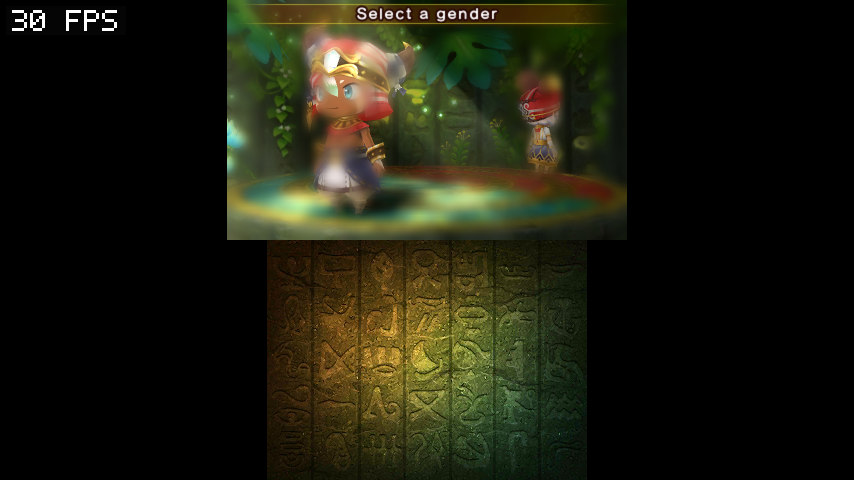
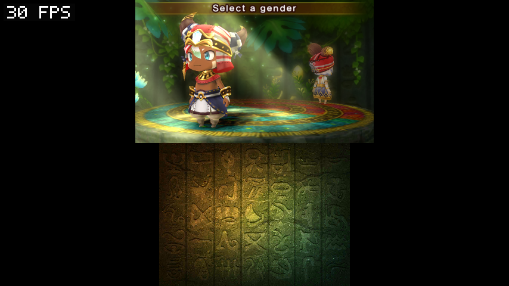
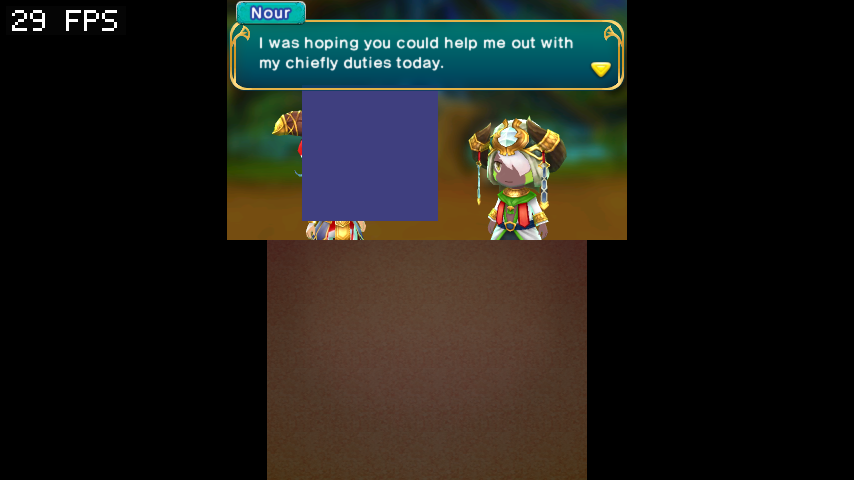
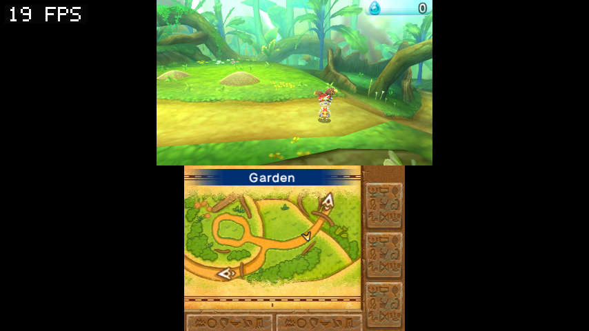
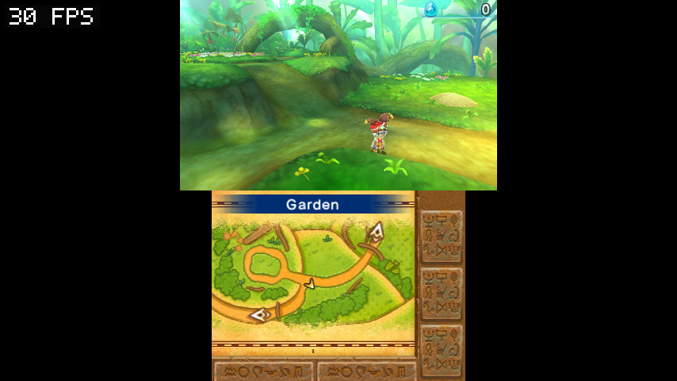

# Ever Oasis: hardware rendering and Garden performance fixes

Ever Oasis v1.1.0 now boots with the verified locale callbacks, preserves the intended background focus and dialogue clipping, and ran the tested Garden scene at **29.9–30.0 FPS on a real Wii U**, compared with **20.0 FPS** before the shader compiler correction. The user confirmed the visual and performance improvements. This is a scene-specific result, not a claim that every room or the whole game sustains 30 FPS.

## Excessive background blur: depth was transformed twice

The vertex shader already emits PICA depth in `[0,1]`. GX2's viewport helper computes `zScale=(far-near)/2` and `zOffset=(near+far)/2`, even with HalfZ clipping enabled. Calling it with near 0 / far 1 therefore applied another `0.5*z+0.5` transform. Ever Oasis copies depth into an RGBA8 texture and uses it to construct its focus mask; the altered values made too much of the background blurry.

We compared a real 3DS screenshot with Azahar's PICA state/VRAM and Wii U render-surface captures. Representative packed-depth high bytes were `245,243,244,242,222` in the reference, while Wii U produced values around `250,249,239,238`, consistent with the extra transform. With the viewport correction, the captured Wii U high-byte modes matched `245,243,244,242,222`.

For the tested US title ID `00040000001A4800`, near **-1** / far **1** makes the viewport depth transform an identity. Other titles keep their current mapping pending validation. We retain the game's depth-based focus effect rather than disabling blur globally.

The transfer path also:

- Copies the observed D24S8-as-RGBA8 depth input on the GPU instead of reading stale clear bytes from guest memory. The shader repacks depth into the guest channel order and averages packed channels when downsampling.
- Allows the qualifying GPU downsample when its source surface is enlarged, avoiding a readback/CPU conversion/reupload round trip.
- Clears first-use destination padding because a visible window can be shorter than its power-of-two allocation; uninitialized MEM2 rows contaminated blur/bloom samples.
- Flushes pending CPU draw batches before choosing a transfer source, preserving ordering.

The depth-copy path is title/format restricted and writes zero into the stencil byte of the packed copy; it is **not a general stencil-preserving transfer implementation**.

These original GamePad captures are from real Wii U hardware. Character animation and capture times differ; they are visual references, not pixel-identical A/B frames. Black regions surrounding the two 3DS screens are expected.

| Before: excessive blur | After: corrected depth mapping |
|---|---|
|  |  |

## Purple rectangle: sampleable depth had lost stencil

The intermediate plain `FLOAT_R32` depth surface made depth sampling usable but removed stencil. Ever Oasis enables stencil during dialogue effects; without that mask, an opaque rectangular effect covered the character's face. A PICA trace of the reference dialogue showed stencil masks/references/operations enabled. Changing vertex compilation modes did not remove the box.

For Ever Oasis depth format 3, use **`GX2_SURFACE_FORMAT_FLOAT_X8_X24` (`0x81c`)**, WUT's legacy name for **D32_FLOAT_S8_X24**, with both depth-buffer and texture usage. This retains float32 depth precision and a stencil channel. The other titles keep `UNORM_R24_X8`, preserving the prior precision fix for closely spaced Mecha Marathon geometry.

The user relaunched on hardware and confirmed that the purple box disappeared. We retained the corrected depth mapping. This format uses 64 bits per pixel: the observed main depth allocation grew from approximately 2 MiB to 4 MiB in MEM1, a cost that should be considered before generalizing it.

This is the **failure** capture. We do not have a matched post-fix dialogue screenshot; removal was confirmed by the hardware playtester. The later Garden captures below do not independently prove dialogue clipping.

## Garden at 20 FPS: false IF-stack overflow in the shader compiler

The hardware report identified **15 CPU vertex fallback draws / 13,062 vertices per presented frame**, including missing vertex key `a3d510a38f5b7082`. The recorded shader variant used bool mask `04e2`; translation rejected instruction `17f` as a ninth IF-stack push.

`SpecGen` incorrectly kept the then branch's IF-depth count while generating a dynamic `IFC`/`IFU` **else** branch. A false PICA condition jumps directly to else and never pushes that entry. Nested else paths therefore looked deeper to the compiler than they were at execution time. The earlier known-false specialized IFU path also needed to avoid consuming a slot.

The correction counts a slot only on a taken specialized IFU path, and decrements/restores IF depth while generating a dynamic else body, matching the existing end-address stack handling. It **does not remove the eight-entry limit** or make a real ninth push legal. The regression test checks known-false IFU at depth eight, nine condition-code branches nested through their else bodies, and rejection of an actual ninth taken push.

After the correction:

- Translation failures across the 17 hardware vertex records fell from **20 variants to zero** (the count includes specialized and runtime-bool variants).
- The exact missing key appeared in the rebuilt pack at vertex index 62.
- The complete rebuilt pack contained 63 vertex shaders; all translated variants compiled successfully with the offline Wii U shader compiler.
- Shader generator revision is now 4 so an old on-console generated-source cache is not reused across these changes.
- Open-bool translation failures now report the entry, bool mask and failing instruction, rather than only incrementing a failure counter.

## Real Wii U validation

The updated RPX and matching `shaders.gsh` / `shaders.idx` were staged over FTP and activated together while the user was on the Wii U Menu. The transfer was **18,889,827 bytes**. Existing game/update assets and saves stayed in place. Prior files were retained for rollback; no payload readback verification was performed, per the user's preference.

The user relaunched Ever Oasis and returned to the Garden. System output remained **480p**; there was **no additional resolution reduction** for the shader compiler comparison. Both the blur and stencil fixes remained enabled.

| Hardware observation | Before shader correction | After shader correction |
|---|---:|---:|
| Measured presentation rate | 20.0 FPS | 30.0 and 29.9 FPS |
| CPU vertex fallback | 15 draws / 13,062 vertices per frame | 0 draws in both reporting windows |
| Fragment shader misses in steady samples | 0 | 0 |
| Texture uploads / GPU readbacks in steady samples | 0 / 0 | 0 / 0 |
| Main scene pass timestamp interval | about 35.6–35.9 ms | 16.22 and 15.86 ms |

The two post-fix samples span approximately five seconds each; the initial uninitialized statistics interval was discarded. [Relevant timing excerpts](evidence/ever-oasis/garden-timing-excerpts.txt) are included. Pass timestamps may include CPU submission gaps and presentation waiting: they are not a measurement of pure shader execution cost. Release CPU per-draw timers remain compile-disabled, so their printed zero values and CPU busy percentage were not used.

| Garden before: capture reads 19 FPS; timed windows measured 20.0 | Garden after: capture reads 30 FPS |
|---|---|
|  |  |

The user independently reported that the fix worked. Extra GPU timing was then disabled and both PC logging channels reconnected. This does not establish long-session stability, performance at 720p, or performance in all other scenes.

## Boot/update compatibility and diagnostics

The base and v1.1.0 BAGE executables contain two locale conversion tables with Thumb callbacks stored as **signed field-relative offsets**, which absolute pointer discovery missed. The builder retains verified entries `00101559`, `0010160d`, `001016c5`, `001017a9` only for the two checked executable SHA-256 values and known BAGE build names. No game code or table payload is included. Updated assets were supplied along with updated code during the v1.1.0 preparation; a later binary-only optimization does not substitute for installing those update assets initially. The updated build reached gender selection in Cemu, followed by the hardware tests above; Cemu was not used as proof of Wii U GPU correctness.

Supporting diagnostics include an on-demand `stats` command, opt-in `set gputime 1` GPU timestamps in a release build, a larger command token buffer so `relaunch` is not truncated, and bounded sampled draw traces with viewport and texture address/size/format information. Timing is disabled by default in the tested release configuration and was turned off after collection. This does not enable the separate alarm-based CPU sampler.

To repeat with the runtime console (one client at a time): request `stats` once to initialize the reporting interval, enable `set gputime 1`, wait for settled reporting windows, then request `stats` about five seconds apart. Finish with `set gputime 0` and reconnect the recorder. Discard transition windows, especially when turning timing back on after a gap; the current timestamp ring can retain stale partial intervals across a toggle. Do not interpret such a window as a long GPU stall. `stats` requests publication through the normal between-frame reporting path.

## Checks and scope

- `python3 tools/test_shader_if_stack.py`: passed.
- `python3 tools/test_surface_retirement.py`: passed; the existing Brain Age archive-retirement correction remains intact.
- `builder/test_compiler_policy.py`: passed all ten policy subcases with the test's Windows platform selection mocked after imports on Linux. This is not a Windows toolchain or full-builder validation.
- Incremental native Linux Wii U build and offline shader compilation: passed.
- `git diff --check`: passed.

Only source, test code, explanatory text, selected user-authorized gameplay screenshots and bounded performance excerpts are included. ROMs, update files, generated game code, game executables, compiled game shader packs, keys and raw session/memory dumps remain local. The renderer depth changes are scoped to the tested US title; the shader control-flow correction is shared and needs wider title coverage.
